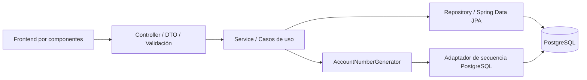

# Arquitectura y decisiones de diseño

## Arquitectura elegida

Monolito modular MVC por capas. Se eligió MVC, una de las opciones permitidas, porque el alcance es pequeño y las transferencias necesitan una transacción local consistente. No se presenta como una arquitectura hexagonal pura: los servicios usan entidades JPA y repositorios Spring Data.

- `entity`: clientes, cuentas, transacciones y movimientos. Identificadores escalares con claves foráneas reales en PostgreSQL; evita serializaciones recursivas y consultas N+1.
- `repository`: consultas y bloqueos pesimistas. No decide reglas comerciales.
- `service`: CRUD, mayoría de edad, cambios de estado, saldos y reversión.
- `controller`: REST, validación de entrada y traducción de errores a Problem Details.
- `dto`: contratos de escritura; no se permite inyectar saldo, número o fechas desde el cliente.
- `static`: frontend HTML/CSS/JavaScript ES modules. Componentes de tabla, formulario, indicadores, estados y mensajes sin dependencias de ejecución.
- `db/migration`: DDL versionado con Flyway. Hibernate valida el esquema y no lo crea automáticamente.

## Patrones aplicados

| Patrón | Implementación y propósito |
|---|---|
| MVC / capas | Controladores REST, servicios, entidades/repositorios y frontend separado por módulos |
| Repository | `CustomerRepository`, `AccountRepository`, `TransactionRepository`, `MovementRepository` |
| Dependency Injection | Inyección por constructor; repositorios y reloj sustituibles en JUnit |
| Strategy / Adapter | `AccountNumberGenerator` con implementación `PostgresAccountNumberGenerator` |
| DTO | Records de entrada validados; separación entre comandos del cliente y datos calculados |
| Unit of Work | `@Transactional` agrupa cuentas, transacción y movimientos en una sola confirmación |
| Idempotencia | UUID `requestId` único para evitar aplicar dos veces una petición repetida |
| Reversión compensatoria | Anulación con asientos inversos sin borrar la evidencia contable |

## SOLID en el código

- **S:** cada servicio administra un agregado funcional; el controlador se limita a HTTP y validación; el generador se ocupa del número de cuenta.
- **O:** se puede añadir otro generador de números implementando el contrato sin cambiar `AccountService`. Añadir un tipo financiero sí exige modificar reglas y migración: los tipos están deliberadamente limitados por el enunciado.
- **L:** implementaciones de repositorios y del generador se usan por su contrato; las pruebas sustituyen dependencias sin modificar el servicio.
- **I:** contrato de generación de números con una única operación. Repositorios separados por entidad. Spring Data aporta su interfaz CRUD estándar.
- **D:** servicios reciben interfaces y `Clock`, no construyen JDBC ni repositorios. Es una aplicación práctica en MVC, sin afirmar independencia total del framework.

## ACID y concurrencia

- **Atomicidad:** consignación, retiro, transferencia y reversión ejecutan en `@Transactional`. Si una validación o escritura falla, se revierte todo, incluso una transacción insertada antes de validar el saldo.
- **Consistencia:** claves primarias/foráneas, unicidad, CHECK, trigger de mayoría de edad y validaciones de negocio. `NUMERIC(19,2)` / `BigDecimal` para dinero. No se calcula dinero con `double` en el backend.
- **Aislamiento:** `SELECT FOR UPDATE` mediante JPA bloquea cuentas; una transferencia las bloquea por ID ascendente para reducir interbloqueos. La comprobación de saldo usa el saldo bloqueado. El estado de cuenta usa `REPEATABLE_READ` para leer saldo y movimientos de una misma instantánea.
- **Durabilidad:** PostgreSQL confirma sobre WAL; Docker conserva datos en `banking-data`. No se deshabilita `fsync`. Se requiere un esquema de copias de seguridad para producción.

Cliente: apertura y eliminación bloquean primero la fila del cliente. El FK impide que se borre mientras conserve productos. `@Version` añade detección de actualizaciones obsoletas en JPA.

Un `requestId` repetido con mismo tipo, importe y cuentas devuelve la operación existente sin afectar saldos. Con datos distintos devuelve 409. En una carrera simultánea, la restricción única garantiza una sola operación; el segundo puede recibir 409 y debe consultar/reintentar con la misma clave. Cambiar la descripción se hace mediante PUT, no mediante un reintento de POST.

## Reglas y supuestos explícitos

1. Moneda única COP. Fechas de negocio en `America/Bogota`; timestamps almacenados con zona horaria.
2. Cliente adulto desde su cumpleaños 18. Se valida también en escrituras SQL directas.
3. Identificación única por tipo y número. Nombres/apellidos se recortan y necesitan 2 caracteres efectivos. Email con dominio y extensión.
4. Cuentas nuevas activas, saldo cero; prefijos 53 y 33, secuencia global no cíclica de ocho dígitos. Las secuencias pueden dejar huecos y no se reutilizan.
5. Cuenta corriente admite saldo negativo porque el enunciado limita explícitamente solo el ahorro. No hay límite de sobregiro configurable. Es un supuesto de la prueba, no una política de crédito lista para producción.
6. Disponible = saldo: el enunciado no define retenciones, bloqueos de fondos ni cupos. Ambos se actualizan conjuntamente y la base comprueba su igualdad.
7. GMF se registra como indicador; no se calcula impuesto, tarifa ni exclusividad de exención porque no se especificaron.
8. Solo se opera sobre cuentas activas. No se permiten transferencias a la misma cuenta.
9. DELETE de producto cancela lógicamente, exige cero y conserva historial. Una cancelada no se reactiva. Cliente con cualquier producto, incluso cancelado, no se elimina.
10. CRUD de transacciones: PUT edita descripción; DELETE anula una vez y genera movimientos inversos. Importe, tipo y cuentas originales se conservan. Para corregirlos, anular y crear. Una reversión que dejaría ahorros negativos falla completamente.
11. Demo local para evaluación: sin autenticación, autorización por operador, paginación, auditoría de identidad o despliegue público. La app y Compose se exponen en loopback. Estos controles deben añadirse antes de uso real.

## Nube

No se han contratado ni desplegado servicios de nube. Se incluye un workflow de GitHub Actions para ejecutar JUnit, integración con PostgreSQL, pruebas de componentes, cobertura y construcción Docker cuando se publique el repositorio. Su existencia no significa que haya corrido en GitHub. Un despliegue futuro puede usar un servicio de contenedores y PostgreSQL administrado; requerirá autenticación, secretos, TLS y copias de seguridad.

## Referencias oficiales

- [Spring Boot: requisitos](https://docs.spring.io/spring-boot/3.5/system-requirements.html)
- [PostgreSQL: transacciones](https://www.postgresql.org/docs/16/tutorial-transactions.html)
- [PostgreSQL: bloqueos explícitos](https://www.postgresql.org/docs/16/explicit-locking.html)
- [Docker Desktop para Windows](https://docs.docker.com/desktop/setup/install/windows-install/)
