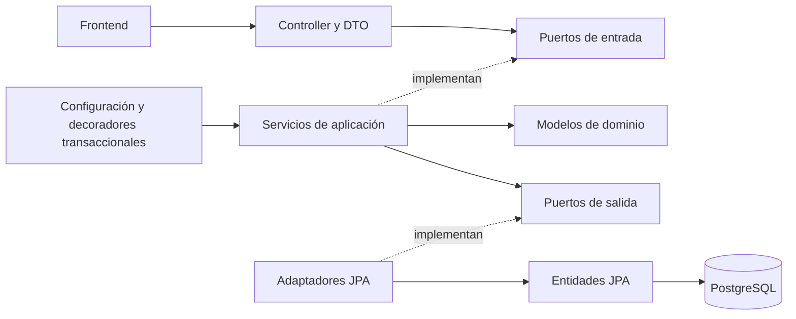

# Arquitectura y decisiones de diseño

## Arquitectura elegida

Monolito con arquitectura hexagonal: dominio y casos de uso Java independientes de Spring, JPA y HTTP. Las capas `entity`, `service`, `controller` y `repository` se conservan por requisito, con responsabilidades explícitas. La guía detallada está en [ARQUITECTURA-HEXAGONAL.md](ARQUITECTURA-HEXAGONAL.md).

## Patrones aplicados

| Patrón | Implementación y propósito |
|---|---|
| Puertos y adaptadores | Interfaces de entrada/salida del núcleo; REST y JPA en los extremos |
| Repository | Contratos de persistencia independientes de Spring Data |
| Dependency Injection | Configuración construye servicios con puertos y reloj |
| Adapter y Mapper | `Jpa*Adapter` traduce entre dominio y entidades persistentes |
| DTO | Entrada HTTP validada convertida explícitamente a comandos Java |
| Decorator y Unit of Work | `Transactional*UseCases` envuelve operaciones completas en transacciones |
| Idempotencia | UUID único evita aplicar dos veces una petición repetida |
| Reversión compensatoria | Anulación con asientos inversos sin borrar evidencia contable |

## SOLID en el código

- **S:** controladores traducen HTTP; servicios deciden reglas; adaptadores persisten y mapean.
- **O:** un nuevo adaptador de almacenamiento o generador implementa los puertos existentes.
- **L:** adaptadores y dobles de prueba cumplen los mismos contratos; los bloqueos requieren una transacción activa.
- **I:** puertos separados por caso de uso y responsabilidad de persistencia, sin exponer todo JpaRepository al núcleo.
- **D:** las interfaces pertenecen al núcleo; Spring y PostgreSQL dependen de ellas. El núcleo compila solamente con el JDK.

## ACID y concurrencia

- **Atomicidad:** consignación, retiro, transferencia y reversión ejecutan dentro de los decoradores `@Transactional`. Si una validación o escritura falla, se revierte todo, incluso una transacción insertada antes de validar el saldo.
- **Consistencia:** claves primarias/foráneas, unicidad, CHECK, trigger de mayoría de edad y validaciones de negocio. `NUMERIC(19,2)` / `BigDecimal` para dinero. No se calcula dinero con `double` en el backend.
- **Aislamiento:** `SELECT FOR UPDATE` mediante JPA bloquea cuentas; una transferencia las bloquea por ID ascendente para reducir interbloqueos. La comprobación de saldo usa el saldo bloqueado. El estado de cuenta usa `REPEATABLE_READ` para leer saldo y movimientos de una misma instantánea.
- **Durabilidad:** PostgreSQL confirma sobre WAL; Docker conserva datos en `banking-data`. No se deshabilita `fsync`. Se requiere un esquema de copias de seguridad para producción.

Cliente: apertura y eliminación bloquean primero la fila del cliente. El FK impide que se borre mientras conserve productos. `@Version` añade detección de actualizaciones obsoletas en JPA.

Un `requestId` repetido con mismo tipo, importe y cuentas devuelve la operación existente sin afectar saldos. Con datos distintos devuelve 409. En una carrera simultánea, la restricción única garantiza una sola operación; el segundo puede recibir 409 y debe consultar/reintentar con la misma clave. Cambiar la descripción se hace mediante PUT, no mediante un reintento de POST.

## Reglas y supuestos explícitos

1. Moneda única COP. Fechas de negocio en `America/Bogota`; timestamps almacenados con zona horaria.
2. Cliente adulto desde su cumpleaños 18. Se valida también en escrituras SQL directas.
3. Identificación única por tipo y número. Nombres/apellidos se recortan y necesitan 2 caracteres efectivos. Email con dominio y extensión.
4. Cuentas nuevas activas, saldo cero; prefijos 53 y 33, secuencia global no cíclica de ocho dígitos. Las secuencias pueden dejar huecos y no se reutilizan.
5. Cuenta corriente admite saldo negativo porque el enunciado limita explícitamente solo el ahorro. No hay límite de sobregiro configurable. Es un supuesto de la prueba, no una política de crédito lista para producción.
6. Disponible = saldo: el enunciado no define retenciones, bloqueos de fondos ni cupos. Ambos se actualizan conjuntamente y la base comprueba su igualdad.
7. GMF se registra como indicador; no se calcula impuesto, tarifa ni exclusividad de exención porque no se especificaron.
8. Solo se opera sobre cuentas activas. No se permiten transferencias a la misma cuenta.
9. DELETE de producto cancela lógicamente, exige cero y conserva historial. Una cancelada no se reactiva. Cliente con cualquier producto, incluso cancelado, no se elimina.
10. CRUD de transacciones: PUT edita descripción; DELETE anula una vez y genera movimientos inversos. Importe, tipo y cuentas originales se conservan. Para corregirlos, anular y crear. Una reversión que dejaría ahorros negativos falla completamente.
11. Demo local para evaluación: sin autenticación, autorización por operador, paginación, auditoría de identidad o despliegue público. La app y Compose se exponen en loopback. Estos controles deben añadirse antes de uso real.

## Nube

La demostración utiliza un servicio Docker gratuito en Render y PostgreSQL en Neon. Las credenciales se configuran como variables de entorno y no se incluyen en GitHub. GitHub Actions ejecuta JUnit, integración PostgreSQL, pruebas de componentes, cobertura y construcción Docker. La configuración de infraestructura está en `render.yaml`.

## Referencias oficiales

- [Spring Boot: requisitos](https://docs.spring.io/spring-boot/3.5/system-requirements.html)
- [PostgreSQL: transacciones](https://www.postgresql.org/docs/16/tutorial-transactions.html)
- [PostgreSQL: bloqueos explícitos](https://www.postgresql.org/docs/16/explicit-locking.html)
- [Docker Desktop para Windows](https://docs.docker.com/desktop/setup/install/windows-install/)

